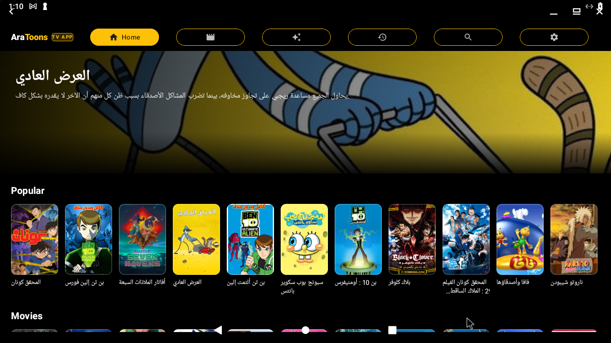
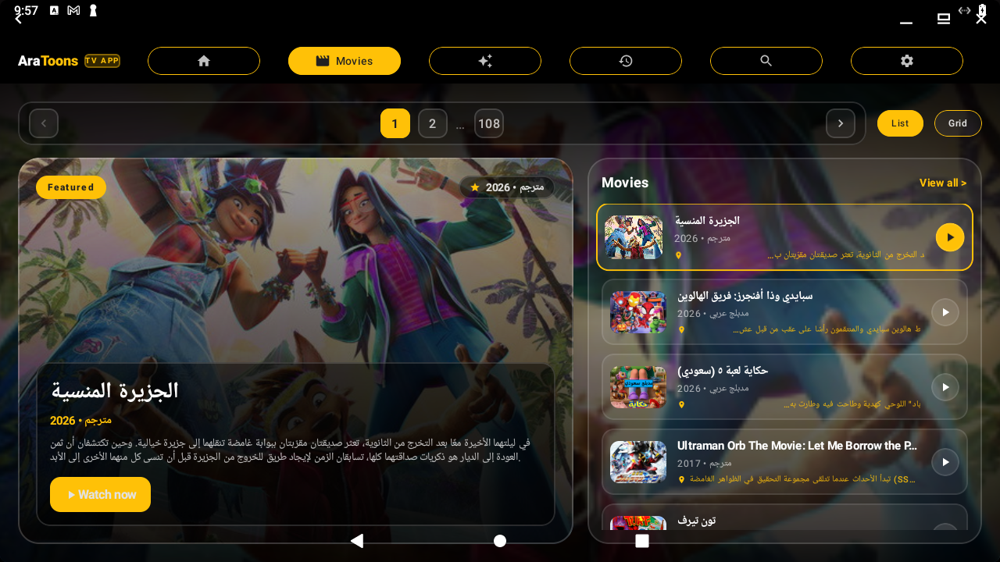
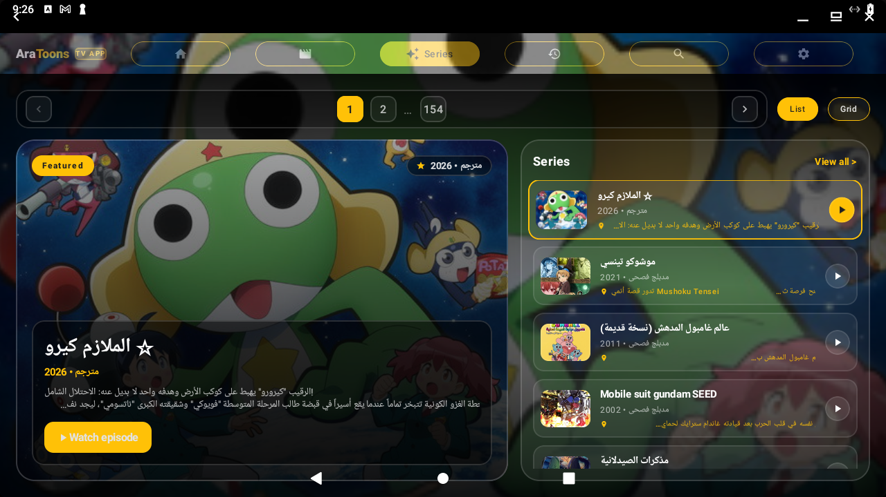
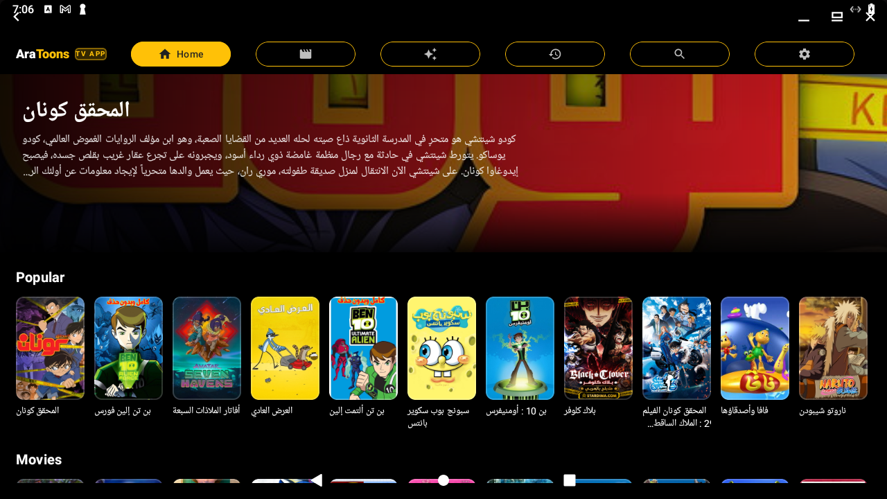
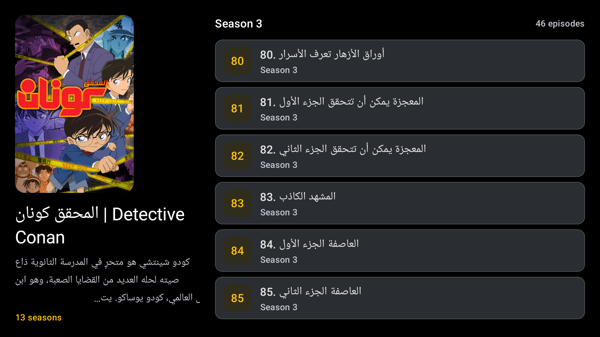
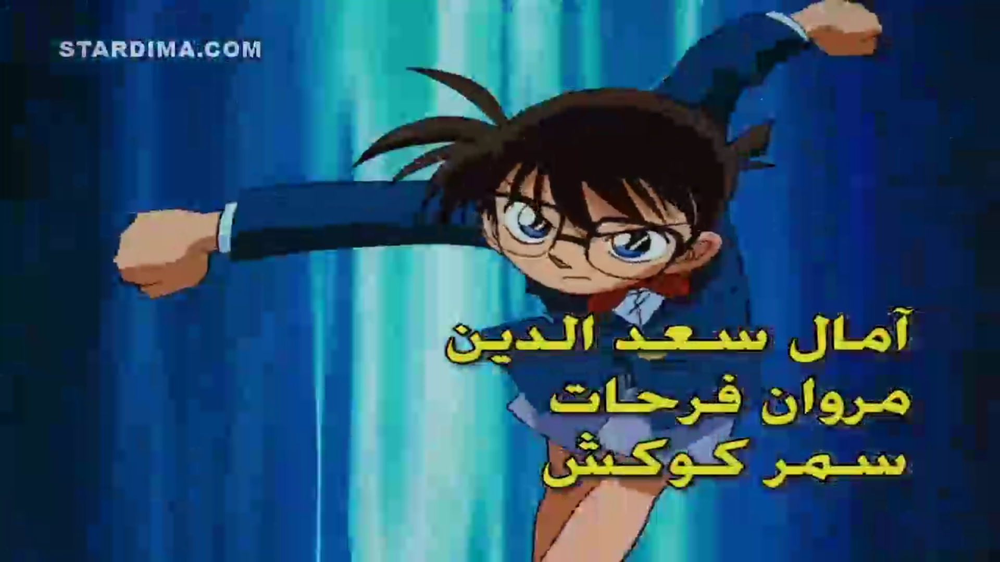
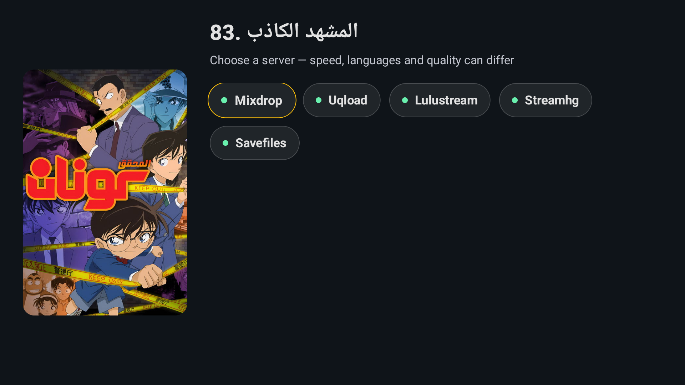

# AraToons — Stardima TV App

**AraToons** is an Android TV application that streams movies and episodes from
[Stardima](https://www.stardima.com) — a large Arabic-language streaming site
for anime, cartoons and movies. It is built with **Kotlin** and **Jetpack
Compose** using the **Material 3** design system, and is optimized for
**10‑foot TV interfaces** (DPAD navigation, focus states, large text and
posters).

The app mirrors the companion [Kodi plugin](plugin.video.stardima) for the
same site, but presents the content in a native Android TV experience.

## Features

- **Movies & Series catalogs** — browse full catalogs with a smooth, blurred
  backdrop and a gradient scrim for legibility.
- **Search** — search movies and series across the site (with pagination).
- **Recently Watched (History)** — keeps your last 50 watched titles; swipe
  a card to remove it.
- **Series detail & seasons** — pick a season, then choose an episode.
- **Server selection** — each episode offers multiple streaming servers
  (Stardima's own, Lulu, MixDrop, Earnvids, etc.); pick the one that plays.
- **Playback** — video plays via **ExoPlayer / Media3** with audio‑track
  choice (Arabic / English when both are available).
- **TV‑first UX** — Material 3, focus‑driven, large type, dark theme.

## Screens

### Home



The **Home** screen. The top navigation bar shows the five tabs
(**Home**, Movies, Featured, History, Search, Settings) as pill buttons, with
the selected tab filled in the accent (gold) colour. Below it is a wide
hero **fanart banner** (with a dark gradient fade for readability) and a
one‑line Arabic description. Under that are horizontal "carousels" of posters
(e.g. *Popular*, *Movies*), each poster with its Arabic title underneath.

### Movies



The **Movies** catalog. The full‑screen backdrop behind the content is the
selected title's poster, blurred (40px) and covered by a **vertical gradient
scrim** (dark at the top and bottom, lighter in the middle) so the content
stays readable. The top tab bar sits on a **solid black** band (the catalog
backdrop is clipped to it). The catalog is a grid of movie posters you can
DPAD around; a highlighted poster shows a larger "spotlight" view.

### Series



The **Series** catalog — identical in layout to Movies, but listing
series. Same smooth blurred backdrop + gradient scrim and black tab bar.
Selecting a series opens its detail page.

### Search



The **Search** screen. A single **rounded search input** (14dp radius, subtle
glass fill) at the top, with a results list below. Typing a query shows
matches across movies and series; each result can be opened to its detail
page or its episode list.

### Server selection



After picking an episode, **AraToons shows the list of available streaming
servers** for that episode (e.g. Stardima, Lulu, MixDrop, Earnvids…). Each
server has a name, quality and status. Tapping one starts playback through
that server's stream. If a server fails, you can go back and pick another.

### Episodes



The **season/episode list**. For a selected series you pick a season, then
browse its episodes (numbered, with Arabic titles). Tapping an episode opens
the **server selection** screen above.

### Player



The **video player** (ExoPlayer / Media3). The selected stream plays with the
app's controls and a bottom progress bar. When both are available, the audio
track (Arabic / English) can be chosen. Playback continues in a focusable TV
player with D‑pad control.

### Recently Watched (History)

The **History** tab (clock icon in the top bar) lists the up to 50 titles you
have played most recently, newest first, as a row of posters with titles.
The title is read back from the `og:title` + `og:image` of the page you last
played. Focusing a card and pressing the context menu lets you **remove it**
from the list.

### Settings

The **Settings** tab (gear icon) holds the app's configuration: language /
UI preferences, default audio‑track behaviour (Arabic‑first when a single
track exists, native track switch during playback), playback/quality options
and app information (version, build).

## Building with Docker

The app is compiled in a containerized Android environment using
[`mingc/android-build-box`](https://github.com/mingc/android-build-box). All
builds are deterministic and cache‑friendly.

### Requirements

- **Docker** (with `/dev/kvm` for the emulator; only needed for the TV test
  emulator, not for builds).
- The `mingc/android-build-box` image (bundles the Android SDK, NDK, build
  tools and Gradle).
- Optional caches (speed up builds):
  - `~/.dockercache/gradle` → mounts to `/root/.gradle`
  - `~/.dockercache/android-sdk-keystore` → the signing keystore (alias
    `androiddebugkey`).

### Debug build

```bash
docker run --rm \
  -v $PWD:/project \
  -v "$HOME/.dockercache/gradle":"/root/.gradle" \
  -v "$HOME/.dockercache/android-sdk-keystore":"/root/.dockercache/android-sdk-keystore" \
  mingc/android-build-box:master \
  bash -c "cd /project && ./gradlew :app:assembleDebug --no-daemon"
```

Output: `app/build/outputs/apk/debug/app-debug.apk`
Copy to `output/` (ignored by Git):

```bash
mkdir -p output
cp app/build/outputs/apk/debug/app-debug.apk \
  "output/stardima-tv-$(grep versionName app/build.gradle.kts | head -1 | grep -o '[0-9.]*')-debug.apk"
```

### Release build (for tagged versions)

```bash
docker run --rm \
  -v $PWD:/project \
  -v "$HOME/.dockercache/gradle":"/root/.gradle" \
  -v "$HOME/.dockercache/android-sdk-keystore":"/root/.dockercache/android-sdk-keystore" \
  mingc/android-build-box:master \
  bash -c "cd /project && ./gradlew :app:assembleRelease --no-daemon"
```

Output: `app/build/outputs/apk/release/app-release.apk`

### Testing on a TV / emulator

The project ships a pre‑configured **Google TV** AVD (`~/.dockercache/avds/
aratoons_tv.avd`, 1280×720, 213dpi). To boot it and sideload:

```bash
docker run -d --name aratoons-emu --device /dev/kvm \
  -v ~/.dockercache/avds:/root/avds \
  -v ~/.dockercache/android-sdk-cache:/sdkcache \
  -v ~/.dockercache/android-sdk-keystore:/root/.dockercache/android-sdk-keystore \
  -v "$HOME/.dockercache/gradle":"/root/.gradle" \
  docker.io/mingc/android-build-box:master sleep infinity

docker exec -d aratoons-emu bash -c '
  export ANDROID_AVD_HOME=/root/avds; export PATH=/opt/android-sdk/platform-tools:$PATH
  /opt/android-sdk/emulator/emulator -avd aratoons_tv -port 5556 \
    -no-window -no-audio -no-boot-anim -gpu swiftshader_indirect \
    -memory 2048 -writable-system > /root/emulator.log 2>&1
'
# once booted (≈20s):
docker exec aratoons-emu bash -c '
  export ANDROID_AVD_HOME=/root/avds; export PATH=/opt/android-sdk/platform-tools:$PATH
  adb -s emulator-5556 install -r /scratch/stardima-tv-debug.apk
  adb -s emulator-5556 shell am start -n com.aionoid.aratoons/.MainActivity
'
```

### Install on a real TV via ADB

```bash
adb install -r output/stardima-tv-<version>-debug.apk
adb shell am start -n com.aionoid.aratoons/.MainActivity
adb logcat -s "StardimaTag" "ExoPlayer" "AndroidRuntime"
```

## Versioning & releases

- **Semantic Versioning** (`MAJOR.MINOR.PATCH`); see [CHANGELOG](CHANGELOG.md).
- Each change is committed, the release APK built and tagged (e.g.
  `v1.0.0`) before the next. The app version lives in
  `app/build.gradle.kts` (`versionName` / `versionCode`).

## License

MIT.
